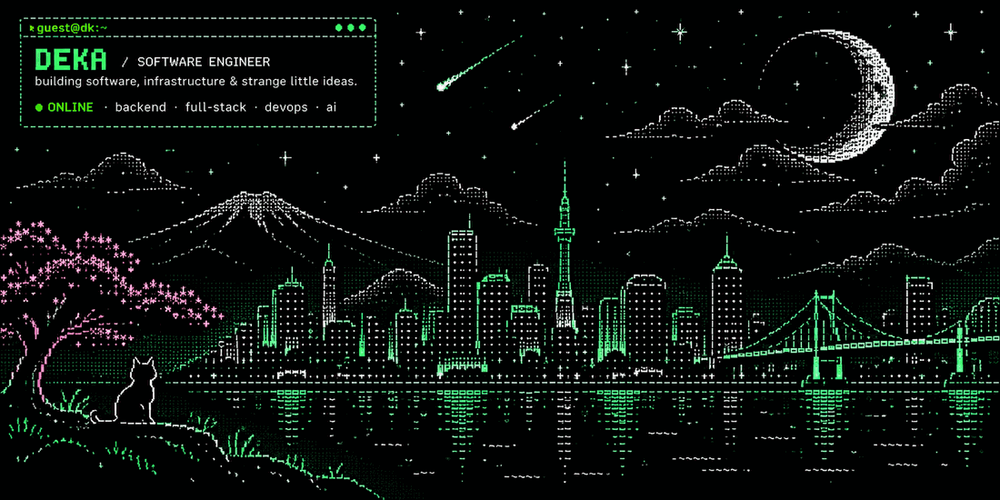

<div align="center">



### `guest@dk:~$ ./identity --show`

# `DEKA_`

**SOFTWARE ENGINEER** `//` **BACKEND · FULL-STACK · DEVOPS · AI**

*Building software, infrastructure & strange little ideas.*

  

[**`[ PORTFOLIO ]`**](https://achmdndy.dev) &nbsp; [**`[ LINKEDIN ]`**](https://www.linkedin.com/in/achmdndy/) &nbsp; [**`[ GITHUB ]`**](https://github.com/achmdndy) &nbsp; [**`[ EMAIL ]`**](mailto:achmdndy@gmail.com)

</div>

---

<table>
<tr>
<td width="56%" valign="top">

### `01 / WHOAMI`

**I build systems, not just features.**

I work across backend APIs, distributed systems, full-stack products, cloud infrastructure and AI experiments.

My approach: **simple where possible, reliable where it matters**, and observable when things go wrong.

`$ echo $MODE` → `build > break > learn > repeat`

</td>
<td width="44%" valign="top">

### `02 / CURRENT.SIGNAL`

```text
[+] backend engineering
[+] distributed systems
[+] kubernetes / gitops
[+] developer tooling
[+] artificial intelligence
[+] shipping side projects
```

</td>
</tr>
</table>

### `03 / TECH.LOADOUT`

| `MODULE` | `TOOLS / TECHNOLOGIES` |
| :--- | :--- |
| `> LANG` | Go · Rust · TypeScript · JavaScript · Python · C# · Java · Dart |
| `> FRONTEND` | React · Next.js · Vue · Angular · Svelte |
| `> BACKEND` | Node.js · Express · Django · .NET · Go |
| `> DATA` | PostgreSQL · MySQL · MongoDB · Redis |
| `> INFRA` | Docker · Kubernetes · Argo CD · GitOps · AWS · Azure · GCP |

<table>
<tr>
<td width="55%" valign="top">

### `04 / EXECUTION.LOG`

```text
$ ./workflow.sh

01  understand the problem
02  remove complexity
03  design the solution
04  build & observe
05  break, learn & fix
06  ship
```

</td>
<td width="45%" valign="top">

### `05 / SYSTEM.PHILOSOPHY`

```text
$ fortune

"Make it work.
 Make it right.
 Make it fast.

 In that order."
```

</td>
</tr>
</table>

---

<div align="center">

`guest@dk:~$ ./connect --help`

**[Portfolio](https://achmdndy.dev)** · **[LinkedIn](https://www.linkedin.com/in/achmdndy/)** · **[GitHub](https://github.com/achmdndy)** · **[Email](mailto:achmdndy@gmail.com)**

<sub><code>[ connection established ] · thanks for stopping by_</code></sub>

</div>
